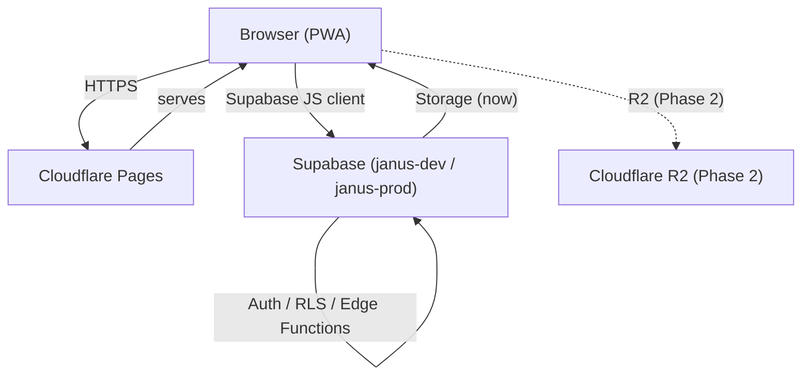

<!-- © Janus — yashxsanjay -->
# planning.md — Architecture Decisions & Current State

This file records BIG changes: decisions that touch core, stack, schema design, module boundaries, storage, hosting, or anything that deviates from BLUEPRINT.md. It is the single source of truth for "why things are the way they are."

See `AGENTS.md §3` for the full classification rules and entry template.

---

## Current Architecture

*(Updated: 2026-10-03 — initial scaffolding, pre-code)*

### System Summary

Janus is a web-first PWA (React + Vite + TypeScript + Tailwind) backed by Supabase (Postgres, Auth, RLS, Edge Functions) and hosted on Cloudflare Pages. Two Supabase projects: `janus-dev` (development) and `janus-prod` (production).

**Status:** Context system and AGENTS.md are written. Project code scaffolding is next. No production system exists yet.

### Modules (planned)

| Module | ID | Flag | Status |
|---|---|---|---|
| Profiles | `profiles` | `profiles.enabled` | Planned (Week 1) |
| Demos | `demos` | `demos.enabled` | Planned (Week 3–4) |
| Feed | `feed` | `feed.enabled` | Planned (Week 5–6) |
| Jobs | `jobs` | `jobs.enabled` | Planned (Week 7–8) |
| Messaging | `messaging` | `messaging.enabled` | Out of MVP scope |
| Stories | `stories` | `stories.enabled` | Out of MVP scope |

### Core Services (planned)

- `src/core/auth` — Supabase Auth wrappers (email, GitHub, Google)
- `src/core/supabase` — Supabase client singleton
- `src/core/config` — Config loader (features.json, theme.json, etc.)
- `src/core/flags` — Feature flag evaluation
- `src/core/event-bus` — Module communication bus
- `src/core/storage` — `StorageProvider` interface (Supabase now, R2 later)
- `src/core/entitlements` — `can(actor, feature)` helper
- `src/core/watermark` — Watermark constants and utilities

### Data Model (planned)

```
profiles (id, user_id, type: builder|company, handle, bio, links, avatar_url, created_at)
content  (id, author_id, type: demo|post|announcement, status, metadata jsonb, created_at)
follows  (follower_id, followee_id, created_at)
reactions (target_type, target_id, user_id, type, created_at)
jobs     (id, company_id, title, details, status, created_at)
applications (id, job_id, applicant_id, demo_id, status, created_at)
reports  (id, reporter_id, target_type, target_id, reason, status, created_at)
blocks   (blocker_id, blocked_id, created_at)
plans    (id, name, features jsonb, price_inr)
subscriptions (id, profile_id, plan_id, status, expires_at)
```

### Storage

Supabase Storage (bucket: `media`) → R2 adapter swap before beta. All storage access goes through `StorageProvider` interface.

### Hosting

Cloudflare Pages. Not yet set up — pending Cloudflare account connection.

### Diagram



---

## Decision Log

### [2026-10-03] Initial project scaffolding and context system

- **Status:** Accepted
- **Context:** Project is greenfield. Need to establish architecture, tooling, and context system before any feature code.
- **Decision:** Adopt the full stack from BLUEPRINT.md (React + Vite + TypeScript + Tailwind, Supabase, Cloudflare Pages, pnpm). Set up the context system (`Context/Agent-Written/`, `AGENTS.md`, `CLAUDE.md`) as specified in the master kickoff prompt. Map `docs/DECISIONS.md` + `docs/ARCHITECTURE.md` → `planning.md`, and `CHANGELOG.md` → `logbook.md`.
- **Alternatives considered:** Vercel — rejected (Hobby plan is non-commercial). Next.js — rejected (overkill for Vite+React setup; Capacitor APK is simpler with Vite). Docker/local Supabase — rejected (too heavy for team's laptop constraints).
- **Impact:** All future agents read `AGENTS.md` → `planning.md` → `logbook.md` at session start. No `docs/DECISIONS.md` or `docs/ARCHITECTURE.md` files will be created.
- **Blueprint deviation:** None. Blueprint references `docs/DECISIONS.md` and `docs/ARCHITECTURE.md` but the master kickoff prompt explicitly maps those to `planning.md`. Blueprint intent is preserved.

### [2026-10-03] Analytics: PostHog free tier selected

- **Status:** Accepted
- **Context:** Blueprint listed PostHog or Umami. Umami requires self-hosting infrastructure (adds ops burden). PostHog has a generous free tier with React SDK.
- **Decision:** Use PostHog free tier for MVP analytics.
- **Alternatives considered:** Umami — open-source, privacy-first, but needs a host (e.g. Railway) which adds complexity and another free tier to manage.
- **Impact:** `posthog-js` added as a dependency. Initialized in `src/app/main.tsx`. PostHog project to be created by Yash.
- **Blueprint deviation:** None (blueprint listed PostHog as first option).
